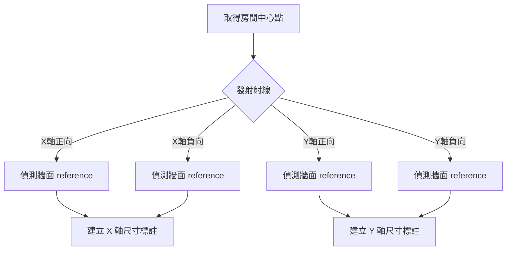

# 自動標註工作流程 (Ray-Casting)

## 多道牆連續淨距與牆厚（Abby）

混合牆柱時改用 `elementIds`（與 `wallIds` 擇一），支援基本牆、建築柱與結構柱。柱採 ComputeReferences 的原始實體／SymbolGeometry 平面參照，依實例 Transform 轉換取樣位置與法向量，不以包圍框代替尺寸參照。每個構件需有兩個明確且垂直標註方向的外側面；回傳 Elements、ColumnWidth／WallThickness／Clearance。非矩形、多面、錯向或相接重疊的構件無法建立完整串時會跳過，保留診斷。

錯位構件或避開開口可指定 `samplePoints: [{elementId,x,y,z}]`（mm）；每點僅能對應已選構件且不可重複。取樣點需落在該構件實際面內，尺寸線仍以 origin、direction、offsetMm 統一定位。取樣不改變模型、不以虛構面補缺口。預覽後核對各構件參照與所有段值，再正式套用，提交後驗證失敗整串回滾。

`create_dimension_by_ray` 可指定 `wallIds: [牆ID1, 牆ID2, ...]`（至少兩道），此時不使用 3D 視圖射線，而以 HostObjectUtils.GetSideFaces 取得選定基本牆的兩側實體面。支援目前水平平面視圖中的直線平行牆；`origin` 必須包含 x/y/z（mm），其在每個面的投影點皆須落在有效面內。`direction` 必須垂直牆身，決定排列方向；offsetMm 為 direction 叉乘世界 Z 方向的平移。開口、缺面、參照不明確或牆體相接重疊時整串跳過，列出原因，不跨過缺失的選定牆，不代用其他牆柱、包圍框或輔助線。

可用 `dimensionTypeId` 指定線性尺寸類型，`offsetMm` 沿牆方向移動尺寸線（預設 500 mm）。預設 `dryRun=true`；只有 `dryRun=false, apply=true` 才建立。先核對 Walls/Faces 的 WallId、StableReference、PointMm 及 Segments（WallThickness／Clearance、ValueMm），再套用。同一視圖已存在相同完整面參照串時回傳 Unchanged；不自動改動既有尺寸類型。正式建立單一 Dimension 後驗證每段尺寸值、段數、類型與參照面，失敗回復交易群組。

此模式一次建立完整連續串，包含第一道到最後一道選定牆的牆厚。不同於舊版逐段射線尺寸，不會自動刪除既有單段標註；替換時應先盤點明確 ID。未提供 wallIds 時維持既有最近射線行為，不能據此宣稱命中特定選取牆。

## 📋 概述

本流程使用「射線偵測技術 (Ray-Casting)」從空間中心向外發射射線，偵測碰到的第一個實體（牆面、柱面），並抓取其幾何參考 (Reference) 來建立關聯性標註。

**核心目標：** 為機電專業 (MEP) 提供精確的空間淨尺寸（Net Clearance）。

## 🎯 適用場景

- **機電淨空間檢討**：標註設備放置空間的有效長寬。
- **走廊寬度檢查**：忽略裝飾材，直接標註結構或完成面淨寬。
- **防火避難分析**：驗證逃生通道的有效寬度。

## 🔧 核心邏輯



### 關鍵參數
*   **Origin**: 射線起點 (通常為 Room Location Point)。
*   **View**: 目標視圖 (必須是平面圖)。
*   **TargetCategory**: 偵測目標 (BuiltInCategory.OST_Walls)。

## 🔄 標準工作流程

### 步驟 1：取得房間資訊
取得房間的 `LocationPoint` 作為射線起點。

```javascript
const room = await execute('get_room_info', { roomId: 12345 });
const center = room.Location;
```

### 步驟 2：執行射線標註
分別對水平 (X) 與垂直 (Y) 方向執行標註。

```javascript
// X 軸向標註 (Horizontal)
execute('create_dimension_by_ray', {
    viewId: activeViewId,
    origin: center,
    direction: { x: 1, y: 0, z: 0 }, // 向右射線 (偵測右牆)
    counterDirection: { x: -1, y: 0, z: 0 } // 向左射線 (偵測左牆)
});

// Y 軸向標註 (Vertical)
execute('create_dimension_by_ray', {
    viewId: activeViewId,
    origin: center,
    direction: { x: 0, y: 1, z: 0 }, // 向上射線
    counterDirection: { x: 0, y: -1, z: 0 } // 向下射線
});
```

## ⚠️ 限制與注意事項

1.  **3D 視圖限制**：`ReferenceIntersector` 必須在 3D 視圖環境下運作（C# 內部處理），但尺寸標註必須建立在平面視圖。
2.  **遮擋問題**：如果房間中間有柱子擋住射線，會標註到柱子而非牆面（這通常也是機電想要的「淨空間」）。
3.  **邊界盒替代**：如果是 L 型或複雜多邊形房間，中心點射線可能打不到預期的牆，需改用「多點射線」或回退到邊界盒法。

---
**維護者：** RevitMCP Team
