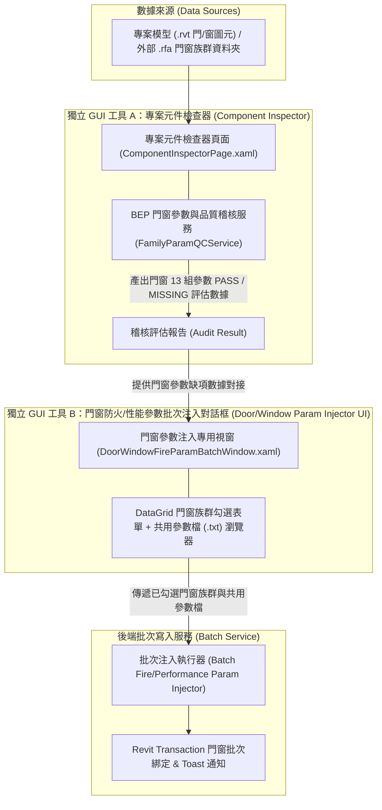

# Revit 門窗批次族群共用參數自動注入與品質稽核對接規範
（Revit Door & Window Batch Shared Parameter Injection & Component Inspector Specification）

## 📌 概述

### 為什麼需要這套流程
在 Revit 中為族群加入共用參數的原生流程相當繁瑣：每個 `.rfa` 都必須「開啟族群編輯器 → 族群類型 → 新增參數 → 選擇共用參數檔與群組 → 設定類型/實體與分組 → 存檔並重新載入專案」。當門窗族群數量一多，就得手動重複數十次，也很容易漏加或分組放錯。

市面上雖有不少插件能處理，但**若不想額外安裝第三方插件**，可依本規範的流程自行處理：先檢查哪些族群缺少參數，勾選後一次批次注入。原作者已將此流程**直接以 Revit C# API 封裝為增益集**實際使用，本文件整理其架構與 API 呼叫重點，供社群參考或自行實作。

### 範圍與架構
本規範訂定 Revit 增益集中「門與窗族群自動注入共用參數（如門窗族群之防火時效、隔熱、遮陽、氣密性能等）」之架構重構與實做標準。適用於**門品類 (`BuiltInCategory.OST_Doors`) 與窗品類 (`BuiltInCategory.OST_Windows`)**。為擺脫過去僅能於單一族群編輯器 (`.rfa`) 環境執行的限制，本規範採用「全量門窗範圍掃描 + 模型檢查器預檢 + WPF 多選清單 + 批次注入服務」之四段解耦架構。

> [!NOTE]
> **架構參考聲明**：
> 本規範中提及之 `CmdInjectDoorFireParams`、`ComponentInspector` (專案元件檢查器) 等類別名稱，源自作者另行開發之獨立增益集，**本研習庫未包含其實做程式碼**。
> 本文件僅供開發架構設計與邏輯參考。

---

## 🏗️ 核心解耦架構

系統區分為**兩套獨立 GUI 工具**與**核心數據服務**，透過 API 與數據通訊進行對接：

---

## 🧩 核心模組與獨立 GUI 職責說明

### 1. 範圍掃描模組 (Scope Scanner)
- **專案內部模式 (In-Project Mode)**：使用 `FilteredElementCollector` 掃描當前專案模型 (`.rvt`) 中所有指定門窗品類：
  - **門品類 (Doors)**：`BuiltInCategory.OST_Doors`（含一般門與帷幕牆門）。
  - **窗品類 (Windows)**：`BuiltInCategory.OST_Windows`（含一般窗與帷幕牆窗）。
- **外部資料夾模式 (External Directory Mode)**：支援指定本機/伺服器資料夾路徑，批次列出所有門窗類別之 `.rfa` 檔案標的。

### 2. 獨立 GUI 工具 A：自訂模型檢查器 (Component Inspector - Standalone Pane / Window)
> [!NOTE]
> **獨立 GUI 工具 1**：擁有專屬之 DockablePane / 主 UI 介面 (`ComponentInspectorPage.xaml`)，為全專案模型門窗與構件品質的通用品質控制台。

> *（註：介面採用 DockablePane 雙欄清單，左側為品類與族群巡檢樹狀檢視，右側展示 13 項 BEP 參數稽核狀態與缺失標記。）*

- **職責分離原則**：注入功能不重覆撰寫參數檢查與名稱規則判斷，直接調用 `ComponentInspector` 服務模組 (`FamilyParamQCService` / `BepParamCheckItem`) 取得既有門窗稽核狀態。
- **門窗狀態標記**：
  - `[PASS]`：門/窗族群已完整包含標的共用參數（例如「防火時效」、「隔熱」）。
  - `[MISSING]`：門/窗族群缺少一或多項標的共用參數。
  - `[PARTIAL]`：僅包含部分參數。

### 3. 獨立 GUI 工具 B：門窗防火/性能參數批次注入對話框 (Multi-Select Checklist Window)
> [!NOTE]
> **獨立 GUI 工具 2**：為門窗參數注入功能專屬啟動之獨立 WPF 彈出式對話框 (`DoorWindowFireParamBatchWindow.xaml`)，非 Component Inspector 頁面內之子元件。

> *（註：介面由頂部篩選工具列、中央 DataGrid 門窗清單與底部注入執行操作列構成。）*

- 遵循 `xaml-decoupled-ui-preview-workflow.md` 與 GUI 設計規範：
  - **嚴禁 Emoji 符號**：採用純 CJK 與標籤 Pill Badges (`[MISSING]`, `[PASS]`, `[PARTIAL]`) 呈現稽核狀態。
  - **解決選取不明確**：DataGrid 行選取 (IsSelected) 採用左側高亮指示條 (`#2563EB`)，不遮蔽稽核背景色；點擊整行自動同步/切換 `IsSelected` CheckBox 勾選。
  - **明確參數類型與分組位置標註**：
    - **參數綁定種類**：`類型參數 (Type Parameter)` (非實體參數)
    - **Revit 屬性分組位置**：`防火保護 (Fire Protection / PG_FIRE_PROTECTION)`
    - **資料類型**：`文字 (String / Text)`
    - **注入標的參數**：`防火時效` (Fire Rating)、`隔熱` (Thermal Insulation)
- 提供品類切換篩選 (全部分類 / 僅門類 / 僅窗類) 與 `CheckBox` 打勾多選功能。
- 具備「一鍵勾選全數缺失門窗族群」、「全選」、「全不選」按鈕，並實時計算勾選統計 breakdown。

### 4. 批次注入執行服務 (Batch Injection Service)
- 讀取共用參數檔 `.txt` 中的標的群組（範例標準：門窗統一檢核「防火時效」與「隔熱」雙參數）：
  - **門群組 (Doors)**：讀取或建立 `防火時效` [String.Text]、`隔熱` [String.Text]。
  - **窗群組 (Windows)**：讀取或建立 `防火時效` [String.Text]、`隔熱` [String.Text]。
- 於 Transaction 交易區段中批次注入：
  - 專案模型環境 (`.rvt`)：透過 `CategoryBinding` 綁定至指定品類 (`OST_Doors` / `OST_Windows`) 之類型參數，分組放置於 `BuiltInParameterGroup.PG_FIRE_PROTECTION` (防火保護)。
  - 族群檔案環境 (`.rfa`)：透過 `FamilyManager.AddParameter(extDef, GroupTypeId.FireProtection, isInstance: false)` 注入。

---

## 🚨 邊界與防禦鐵律

1. **靜默與重覆注入防護**：
   - 注入前必須先比對門/窗族群既有參數清單，若參數已存在，則自動跳過，禁止產生同名參數競爭或例外拋出。
2. **Transaction 交易安全**：
   - 批次寫入時，每一個門窗族群或專案變更必須於安全的 Transaction 內執行。遇錯誤時立即 Rollback 並記載 Log。
3. **通知體驗規範**：
   - 遵照 `revit-gui-toast-notification-spec.md` 規範：
     - 批次注入完成：發出非阻塞 WPF Toast 彈窗通知成功注入的門窗族群數量。
     - 例外錯誤：僅在發生不可預期 Exception 時使用 TaskDialog 搭配 `ExpandedContent` 呈現 Traceback。

---

## 📝 模組與類別對照表

| 模組分工 | 工具類型 | 對應類別 / 檔案 | 備註說明 |
| :--- | :--- | :--- | :--- |
| **按鈕命令進入點** | ExternalCommand | `CmdInjectDoorFireParams` | 啟動獨立 GUI 工具 B (門窗注入對話框) |
| **GUI 工具 A** | 獨立控制台 UI | `ComponentInspectorPage.xaml` | 專案全量門窗與構件品質稽核 DockablePane |
| **稽核器服務** | Service Layer | `BepParamCheckItem` / `FamilyParamQCService` | 門窗參數狀態評估 |
| **GUI 工具 B** | 獨立功能對話框 | `DoorWindowFireParamBatchWindow.xaml` | 門/窗防火與性能參數注入專用多選清單表單 |
